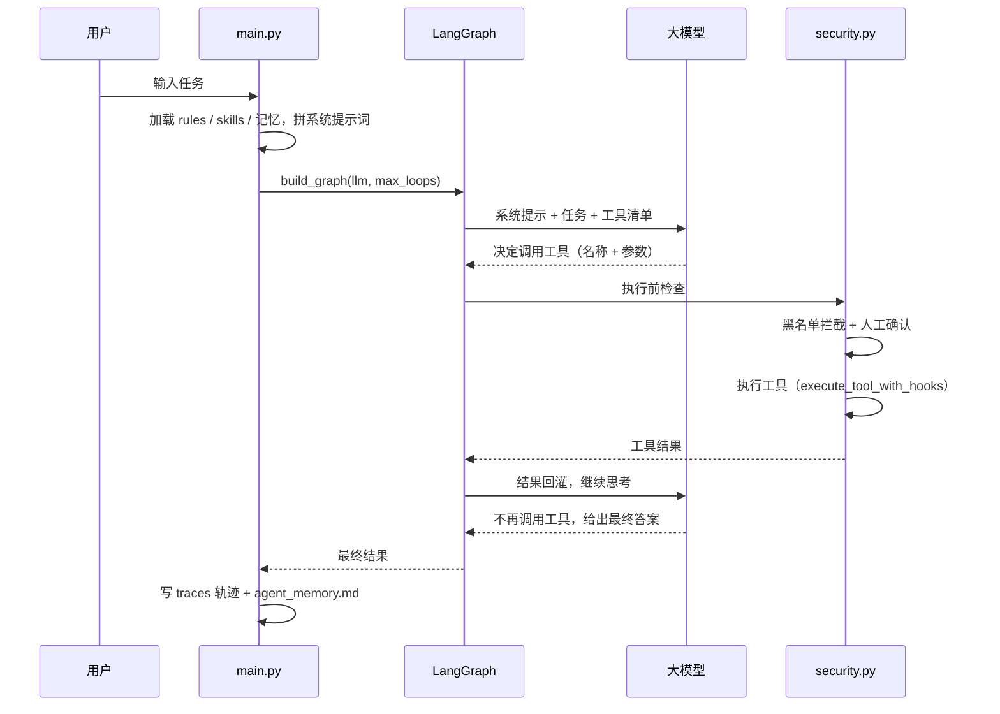

# AgentForge

> 一个跑得通的编程智能体最小框架：用一句自然语言，让 AI 自己读代码、改文件、执行命令、验证结果。

AgentForge 基于 **LangGraph + LangChain** 构建，兼容任何 OpenAI 协议的大模型服务（DeepSeek、OpenAI、本地 vLLM 等）。它不是又一个聊天窗口，而是一个**会动手的 Agent**：

- 你给任务，模型自己决定调用哪个工具、按什么顺序调用；
- 每一步的执行结果会回灌给模型，由它决定继续还是收尾；
- 全过程有安全拦截、有跨会话记忆、有完整轨迹存档。

项目刻意保持小而透明：核心链路（循环、工具、安全、记忆、轨迹）全部可读、可跑、可改，适合作为学习 Agent 原理的起点，也适合在它之上快速搭建自己的实验。

---

## 核心特性

| 特性 | 说明 |
| --- | --- |
| 🔁 自主工具循环 | LangGraph 驱动的 `agent ⇄ tools` 循环，模型不再请求工具时自动结束，并设有最大轮次保护 |
| 🧰 7 个内置工具 | 读文件、写文件、精确编辑、正则搜索、文件查找、Shell 执行、临时子智能体 |
| 🛡️ 三层安全防护 | 高危命令黑名单 → 人工确认（Y/N/Q）→ 工具输出截断 |
| 🧠 跨会话记忆 | 任务与结果摘要持久化到 `agent_memory.md`，下次启动自动注入系统提示词 |
| 📦 上下文压缩 | 消息超过阈值时自动总结旧对话，只保留最近若干轮，避免上下文爆炸 |
| 📜 规则与技能注入 | 自动加载 `.agent/rules/*.md` 与 `.agent/skills/*.json`，无需改代码即可定制行为 |
| 🧾 完整执行轨迹 | 每次任务生成 Markdown 轨迹，包含模型思考、工具调用、参数与结果 |
| 👥 多 Agent 团队模式 | 主模型担任项目经理拆解任务，多个角色顺序执行，最后由审查者汇总 |
| 🔌 模型可替换 | 基于 OpenAI 兼容协议，改 `.env` 即可切换云端或本地模型 |

---

## 工作原理

Agent 的秘密只有一句话：**模型不直接干活，它只负责"决定调用什么工具"；真正执行的是框架代码。**



单次任务的最小闭环：

1. **组装提示词**：项目规则 + 技能提示 + 历史记忆 + 系统人设；
2. **进入图循环**：模型思考 → 产生 `tool_calls` → 安全校验 → 执行工具 → 结果回灌；
3. **终止**：模型不再请求工具，或达到 `max_loops` 上限；
4. **落盘**：完整轨迹写入 `traces/`，任务摘要追加到 `agent_memory.md`。

---

## 快速开始

### 1. 环境要求

- Python **3.10+**（建议 3.11）
- 一个支持 OpenAI 协议与 Function Calling 的模型服务

### 2. 安装依赖

使用 pip：

```bash
python -m venv .venv
source .venv/bin/activate
pip install -r requirements.txt
cp .env.example .env
```

使用 uv（推荐，已提供 `uv.lock`）：

```bash
pip install uv
uv sync
cp .env.example .env
```

### 3. 配置 `.env`

```dotenv
# 云端模型（OpenAI 兼容接口）
OPENAI_API_KEY=你的 API Key
OPENAI_BASE_URL=https://api.deepseek.com/v1
MODEL_NAME=deepseek-v4-pro
TEAM_MODEL_NAME=deepseek-flash

# 可选：本地模型
LOCAL_BASE_URL=http://localhost:8000/v1
LOCAL_MODEL_NAME=qwen3
```

| 变量 | 作用 | 默认值 |
| --- | --- | --- |
| `OPENAI_API_KEY` | 模型服务密钥 | `not-needed` |
| `OPENAI_BASE_URL` | 模型服务地址 | `https://api.deepseek.com/v1` |
| `MODEL_NAME` | 单 Agent / PM 使用的模型 | `deepseek-v4-pro` |
| `TEAM_MODEL_NAME` | 团队成员使用的模型 | `deepseek-flash` |
| `LOCAL_BASE_URL` | 本地模型服务地址 | `http://localhost:8000/v1` |
| `LOCAL_MODEL_NAME` | 本地模型名称 | `qwen3` |

`.env` 已被 `.gitignore` 忽略，请勿提交 API Key。

> 使用本地模型时，除填写上述变量外，还需将 `config.py` 中 `llm` / `team_llm` 的赋值改为 `llm_local`（或自行封装模型切换逻辑）。

### 4. 跑第一个任务

```bash
python main.py --auto "统计当前目录下有多少个 Python 文件，并把结果写入 count.txt"
```

使用 uv 时可以写成 `uv run main.py ...`。

你会看到类似输出：

```text
[Agent 决定调用工具]: bash
   参数: {'command': "find . -maxdepth 1 -type f -name '*.py' | wc -l"}

[工具执行结果]:
9

[Agent 决定调用工具]: write
   参数: {'path': 'count.txt', 'content': '9\n'}

[工具执行结果]:
成功写入 2 个字符到 count.txt

[Agent 思考]:
已完成。当前目录下共有 9 个 Python 文件，结果已写入 count.txt。
```

---

## 使用方法

```bash
python main.py [--auto] [--team] <任务描述>
```

| 模式 | 命令 | 行为 |
| --- | --- | --- |
| 交互确认（默认） | `python main.py "任务"` | 执行 `bash` / `edit` 前暂停，等待 `[Y/N/Q]` |
| 自动执行 | `python main.py --auto "任务"` | 自动批准所有工具；高危命令仍会被黑名单拦截 |
| 团队模式 | `python main.py --team "任务"` | 先由 PM 拆解任务，再多角色顺序执行并汇总 |
| 团队 + 自动 | `python main.py --team --auto "任务"` | 团队模式下无人值守执行 |

交互确认说明：

- `Y`：允许执行本次工具调用
- `N`：拒绝本次工具调用，模型会收到"用户拒绝"并尝试其他方案
- `Q`：立即终止程序

### 任务示例

```bash
# 代码理解（只读，安全）
python main.py "读一遍 graph.py 和 tools.py，解释 Agent 循环是怎么结束的"

# 自动统计与落盘
python main.py --auto "统计每个 .py 文件的行数，写入 stats.txt"

# 搜索与风险排查
python main.py --auto "找出项目里所有 subprocess 调用并列出风险点"

# 团队协作
python main.py --team --auto "分析项目结构，生成一份架构说明写入 ARCHITECTURE.md"
```

### 团队模式如何工作

1. 主模型（PM）把任务拆成 JSON：`{"team": [{"name", "role", "task"}, ...]}`；
2. 每个成员是一个独立 Agent，拥有独立上下文和图实例，最多 30 轮工具循环；
3. 成员顺序执行，完成后向其他人广播工作摘要；
4. 名单最后一名成员负责最终审查与整合；
5. PM 规划失败时自动退化为单 Agent 模式。

---

## 内置工具

| 工具 | 能力 | 需要确认 | 说明 |
| --- | --- | --- | --- |
| `read` | 读取文件 | 否 | 支持 `offset` / `limit`，返回带行号内容 |
| `write` | 写入文件 | 否 | 自动创建父目录 |
| `edit` | 精确替换文本 | 是 | 要求 `old_string` 在文件中唯一匹配 |
| `grep` | 递归正则搜索 | 否 | 30 秒超时 |
| `glob` | 按模式查找文件 | 否 | 结果按修改时间倒序 |
| `bash` | 执行 Shell 命令 | 是 | 30 秒超时，高危命令直接拦截 |
| `subagent` | 启动一次性子智能体 | 否 | 独立上下文，最多 10 轮；其内部工具调用仍经过安全管道 |

所有工具统一通过 `execute_tool_with_hooks` 执行，安全策略集中在一处，便于扩展审计、限流等 Hook。

---

## 项目结构

```text
agent-forge/
├── .agent/                     # Agent 行为配置（无需改代码）
│   ├── mcp.json                # MCP 服务配置（预留）
│   ├── rules/
│   │   └── project.md          # 项目规则，自动注入系统提示词
│   └── skills/
│       └── file-analysis.json  # 技能元数据，自动注入系统提示词
├── traces/                     # 执行轨迹输出目录
├── agent_memory.md             # 跨会话记忆（运行时生成）
├── .env.example                # 环境变量模板
├── config.py                   # 模型实例与全局开关
├── context.py                  # 上下文压缩
├── graph.py                    # LangGraph 图定义
├── logger.py                   # 轨迹落盘
├── main.py                     # CLI 入口与单/多 Agent 编排
├── memory.py                   # 记忆加载与持久化
├── prompt.py                   # 系统提示词组装
├── security.py                 # 安全防护与工具执行 Hook
├── tools.py                    # 工具实现与注册
├── pyproject.toml              # 项目与依赖声明
├── requirements.txt            # pip 依赖清单
└── uv.lock                     # uv 锁定文件
```

## 模块说明

| 文件 | 职责 |
| --- | --- |
| `config.py` | 从 `.env` 创建 `llm` / `team_llm` / `llm_local`，维护 `AUTO_APPROVE` 开关 |
| `graph.py` | 定义 `AgentState`、`agent` 节点、`tools` 节点、条件边与循环上限 |
| `tools.py` | 7 个工具的 LangChain 实现，统一导出 `ALL_TOOLS` |
| `security.py` | 危险命令黑名单、人工确认、输出截断、工具执行 Hook |
| `prompt.py` | 加载 Rules / Skills / MCP 配置，拼接系统提示词 |
| `memory.py` | `agent_memory.md` 的读取（最近 50 行）与追加写入（结果截断 500 字） |
| `context.py` | 消息超过 20 条时调用模型总结旧对话，保留最近 6 条 |
| `logger.py` | 将完整消息流渲染为 Markdown 轨迹 |
| `main.py` | 命令行解析、单 Agent 执行、团队编排、结果打印 |

---

## 运行产物

| 文件 | 内容 |
| --- | --- |
| `agent_memory.md` | 每个任务的时间、任务描述、结果摘要（≤500 字），下次启动作为历史记忆注入 |
| `traces/<时间戳>_<任务名>.md` | 完整执行轨迹：SYSTEM / HUMAN / AI / TOOL 消息、工具调用参数与结果 |
| 任务指定文件 | 例如示例中的 `count.txt`、`stats.txt` |

> 轨迹文件名会自动过滤特殊字符并截断到 50 字符，避免非法路径。

---

## 安全机制

1. **危险命令黑名单**：拦截 `rm -rf /`、`rm -rf *`、`mkfs`、`dd of=/dev/`、`chmod -R 777 /`、`curl/wget | sh` 等模式；
2. **人工确认**：`bash` 与 `edit` 默认暂停等待 `[Y/N/Q]`，`--auto` 可跳过；
3. **输出截断**：工具输出超过 5000 字符时，保留首尾各 2500 字符，防止上下文被单次输出撑爆；
4. **统一执行入口**：所有工具调用都经过 `execute_tool_with_hooks`，便于集中加固。

> ⚠️ 黑名单只能降低误操作概率，**不是沙箱**。`write` 等工具无需确认即可执行。建议在容器、虚拟机或专用目录中运行，并妥善保管 API Key。

---

## 扩展指南

### 新增一个工具

在 `tools.py` 中定义函数并加入 `ALL_TOOLS`：

```python
from langchain_core.tools import tool

@tool
def count_files(pattern: str = "*.py") -> str:
    """统计匹配给定 glob 模式的文件数量。"""
    import glob
    return str(len(glob.glob(pattern, recursive=True)))

ALL_TOOLS = [read, write, edit, grep, glob, bash, subagent, count_files]
```

工具的**名称和 docstring 会发给模型**用于决策，描述写得越清楚，调用越准确。

### 新增项目规则

在 `.agent/rules/` 下放置任意 `.md` 文件，内容会在下次启动时自动注入系统提示词。例如：

```markdown
- 修改文件前必须先读取目标文件。
- 完成后必须给出可验证的结果。
```

### 新增技能说明

在 `.agent/skills/` 下放置 JSON 元数据：

```json
{
  "name": "file-analysis",
  "description": "统计目录文件、检索内容并汇总结果"
}
```

> 当前技能仅注入 `name` 与 `description`，不包含技能正文或执行逻辑。

### 接入 MCP

`prompt.py` 已预留 `load_mcp_tools()`，但**尚未接入执行链路**。若要启用：

1. 在 `.agent/mcp.json` 中配置 `mcpServers`；
2. 使用 `langchain-mcp-adapters` 将 MCP 工具转换为 LangChain `StructuredTool`；
3. 在构建图之前将转换后的工具合并进 `ALL_TOOLS` 并一起 `bind_tools`。

### 加入人工提问 / 中断

当前 Agent 不会主动追问需求。可选方案：

- 在 `tools.py` 增加 `ask_user` 工具，内部通过 `input()` 收集回答；
- 或在 `graph.py` 中使用 LangGraph 的 `interrupt()` 实现可恢复的人机中断。

### 切换模型

- 云端模型：修改 `.env` 中的 `MODEL_NAME` / `TEAM_MODEL_NAME`；
- 本地模型：填写 `LOCAL_*` 变量，并将 `config.py` 中的 `llm` / `team_llm` 替换为 `llm_local`。

---

## 当前状态与路线图

**已实现并验证**

- [x] 单 Agent 工具循环（最多 10 轮）
- [x] 多 Agent 团队模式（成员最多 30 轮，PM 失败自动退化）
- [x] 7 个内置工具与统一安全 Hook
- [x] 高危命令黑名单、人工确认、输出截断
- [x] 跨会话记忆、上下文压缩
- [x] Rules / Skills 元数据注入
- [x] 完整执行轨迹落盘

**预留 / 待完善**

- [ ] MCP 工具真正接入执行链路
- [ ] Skills 正文加载与按需执行
- [ ] Agent 主动提问（`ask_user` / `interrupt`）
- [ ] 模型流式输出
- [ ] 向量检索式长期记忆
- [ ] 团队成员并行执行与任务依赖图
- [ ] 会话 checkpoint 与断点恢复
- [ ] 重试、退避、结构化日志
- [ ] 单元测试与沙箱执行环境

---

## 常见问题

**Q：模型不调用工具，直接给答案？**
先确认所用模型支持 Function Calling；再检查任务是否足够具体。工具描述不清也会导致模型"忘记"工具的存在。

**Q：任务跑偏或反复试错？**
把任务写具体（目标、文件、验收标准），或拆成两步：先只读分析，确认方案后再执行修改。

**Q：如何安全地试玩？**
在专用目录或容器中运行；先用只读任务（`read` / `grep` / `glob`）观察行为，再放开写操作。生产环境请勿使用 `--auto`。

**Q：为什么每次运行都是全新对话？**
当前没有 checkpoint 机制，跨任务上下文只通过 `agent_memory.md` 传递摘要。

**Q：如何终止运行？**
交互确认时输入 `Q`；任何时刻都可以 `Ctrl+C`。

**Q：支持哪些模型服务？**
任何兼容 OpenAI Chat Completions 与 Function Calling 协议的服务，包括 DeepSeek、OpenAI、vLLM、Ollama（OpenAI 兼容模式）等。

